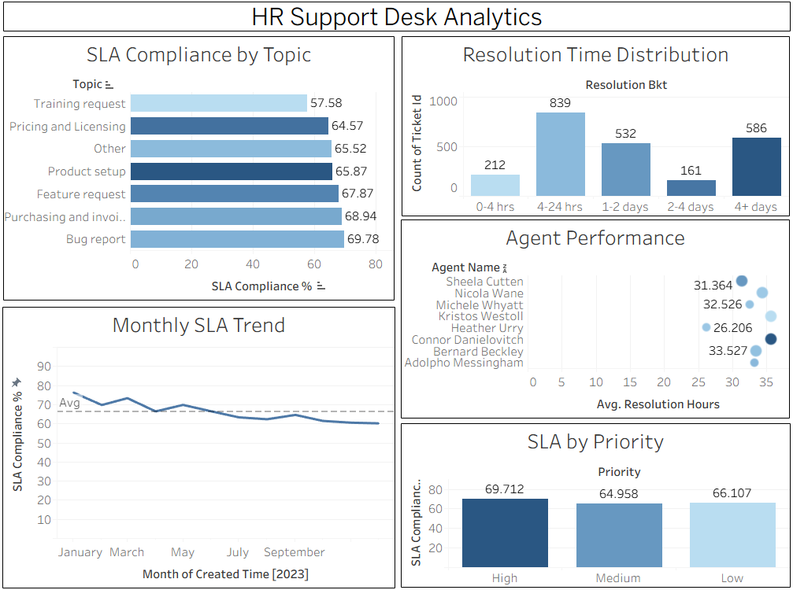

# 📊 HR Support Desk Analytics

A data analytics project built to analyze support desk operations — covering SLA compliance, agent performance, resolution times, and ticket volume trends.

Built using **SQLite**, **Python (Pandas)**, and **Tableau Public**.

---

## 📌 Project Overview

This project analyzes 2,330 real support tickets from a technical support dataset to uncover operational inefficiencies and performance trends in a support desk environment — the kind of insights an HR Ops or People Analytics team would act on.

### Key Business Questions Answered:
- Which request categories breach SLA the most?
- Is SLA compliance improving or declining over time?
- Which agents are performing best on resolution time and satisfaction?
- How long does it take to resolve tickets?
- Are high-priority tickets being resolved faster than low-priority ones?

---

## 📷 Dashboard Preview



---

## 🔍 Key Findings

| Finding | Insight |
|---|---|
| **Training Requests** have the worst SLA compliance at **57.6%** | Needs urgent attention — likely understaffed or undertrained |
| **SLA compliance dropped from 76% to 60%** over 12 months | A consistent downward trend — workload may be outpacing capacity |
| **High priority tickets don't resolve faster than Low priority** | Priority flagging system may not be working effectively |
| **839 tickets (36%)** take 4-24 hours to resolve | Majority of tickets resolved same day — a positive sign |
| **586 tickets take 4+ days** | Long tail of unresolved tickets needs investigation |
| **Connor Danielovitch** has the fastest avg resolution time at **26.2 hrs** | Could be used as a benchmark for other agents |

---

## 🗂️ Project Structure

  ```
 hr-support-desk-analytics/
  ├── tickets_clean.csv       # Cleaned dataset (2,330 rows)
  ├── analysis.sql            # All SQL queries with comments
  ├── data_cleaning.ipynb     # Python data loading and cleaning
  ├── dashboard.png           # Dashboard screenshot
  └── README.md

  ```

## 🛠️ Tools Used

| Tool | Purpose |
|---|---|
| **SQLite** | Database storage and analytical queries |
| **Python (Pandas)** | Data loading, cleaning, CSV export |
| **Jupyter Notebook** | Interactive data exploration |
| **Tableau Public** | Dashboard visualization |

---

## 🧹 Data Cleaning Steps

The raw dataset required the following cleaning before analysis:

1. **Duplicate topic labels** — 'Pricing and licensing' and 'Pricing and Licensing' were two separate values due to inconsistent casing. Normalized to title case.
2. **Whitespace** — All text columns trimmed using TRIM()
3. **Date formatting** — Timestamps trimmed to YYYY-MM-DD HH:MM:SS format using SUBSTR()
4. **SLA binary flags** — Created sla_met (1/0) column from text values for easier aggregation in SQL and Tableau
5. **Null handling** — 418 tickets have no resolution time (open/in-progress) — excluded from resolution time calculations

---

## 📊 SQL Queries

Five analytical queries power the dashboard:

### Q1: SLA Compliance by Topic
```sql
SELECT
    topic,
    COUNT(*) AS total_tickets,
    SUM(sla_met) AS sla_met_count,
    ROUND(SUM(sla_met) * 100.0 / COUNT(*), 1) AS sla_compliance_pct
FROM tickets
GROUP BY topic
ORDER BY sla_compliance_pct ASC;
```

### Q2: Monthly SLA Trend
```sql
SELECT
    SUBSTR(created_time, 1, 7) AS month,
    COUNT(*) AS total_tickets,
    ROUND(SUM(sla_met) * 100.0 / COUNT(*), 1) AS sla_compliance_pct
FROM tickets
WHERE created_time IS NOT NULL
GROUP BY month
ORDER BY month;
```

### Q3: Agent Performance
```sql
SELECT
    agent_name,
    COUNT(*) AS total_tickets,
    ROUND(AVG(survey_score), 2) AS avg_satisfaction,
    ROUND(SUM(sla_met) * 100.0 / COUNT(*), 1) AS sla_compliance_pct,
    ROUND(AVG(agent_interactions), 2) AS avg_interactions
FROM tickets
GROUP BY agent_name
ORDER BY total_tickets DESC;
```

### Q4: Resolution Time Distribution
```sql
SELECT
    CASE
        WHEN ROUND((JULIANDAY(resolution_time) - JULIANDAY(created_time)) * 24, 1) <= 4 THEN '0-4 hrs'
        WHEN ROUND((JULIANDAY(resolution_time) - JULIANDAY(created_time)) * 24, 1) <= 24 THEN '4-24 hrs'
        WHEN ROUND((JULIANDAY(resolution_time) - JULIANDAY(created_time)) * 24, 1) <= 48 THEN '1-2 days'
        WHEN ROUND((JULIANDAY(resolution_time) - JULIANDAY(created_time)) * 24, 1) <= 96 THEN '2-4 days'
        ELSE '4+ days'
    END AS resolution_bucket,
    COUNT(*) AS ticket_count
FROM tickets
WHERE resolution_time IS NOT NULL
GROUP BY resolution_bucket;
```

### Q5: SLA Compliance by Priority
```sql
SELECT
    priority,
    COUNT(*) AS total_tickets,
    ROUND(SUM(sla_met) * 100.0 / COUNT(*), 1) AS sla_compliance_pct,
    ROUND(AVG(
        CASE WHEN resolution_time IS NOT NULL
             THEN (JULIANDAY(resolution_time) - JULIANDAY(created_time)) * 24
        END
    ), 1) AS avg_resolution_hrs
FROM tickets
GROUP BY priority
ORDER BY CASE priority WHEN 'High' THEN 1 WHEN 'Medium' THEN 2 ELSE 3 END;
```

---

## 📁 Dataset

- **Source:** [Technical Support Dataset — Kaggle](https://www.kaggle.com/datasets/suvroo/technical-support-dataset)
- **Size:** 2,330 tickets
- **Period:** January 2023 — December 2023
- **Fields:** Ticket ID, Status, Priority, Topic, Agent, Created Time, Resolution Time, SLA Status, Survey Score, Country

---

## How to Run

```bash
# Clone the repo
git clone https://github.com/vigneshwari2408/hr-support-desk-analytics.git
cd hr-support-desk-analytics

# Install dependencies
pip install pandas jupyter

# Explore the cleaning steps
jupyter notebook data_cleaning.ipynb

# Run the SQL queries against tickets_clean.csv using SQLite or DB Browser for SQLite,
# or open analysis.sql directly
```

---

## About

**Vigneshwari Nalla** — MSc Data Analytics for Business, KEDGE Business School  
[LinkedIn](https://linkedin.com/in/vigna24) · [Portfolio](https://vigneshwari2408.github.io/vigneshwari-portfolio/) · [GitHub](https://github.com/vigneshwari2408)
